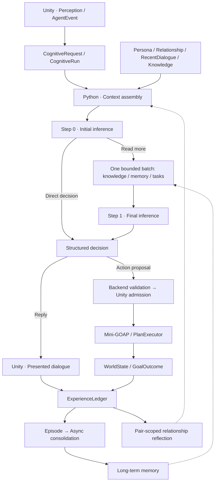

[简体中文](ARCHITECTURE.md) | [English](ARCHITECTURE.en.md)

# EmbodiedNPC Architecture

EmbodiedNPC combines a **Unity-authoritative game world** with a **Python cognition backend**. Its current demo is a café with four NPCs. The architecture connects **perception → cognition → action → memory and reflection** so that actual dialogue and world outcomes inform later interactions.

## Runtime overview

These arrows show control and data flow. Retrieval, action execution, and consolidation run when applicable. Unity determines current world state and completed actions; model output supplies a reply or a checked action proposal.

## 1. Perception

Each NPC maintains observer-local visual, proximity, and auditory state. Vision periodically samples nearby entities using distance, field-of-view and occlusion tests. Observations update `PerceivedState` without invoking an LLM at each scan.

Player speech, waving, and world changes are represented as `AgentEvent`. Routing delivers targeted requests to the intended NPC, while interest evaluation decides whether to ignore, record, or wake cognition. Nearby NPCs may observe speech through a separate hearing path. `AgentOrchestrator` owns one foreground `CognitiveRun` per NPC.

## 2. Cognition

`CognitiveContextComposer` captures a bounded snapshot of the event, perception, character, daily mode, relevant player and available capabilities. The Backend adds recent dialogue, relationship summary, authorized world knowledge and model instructions.

- **Persona:** identity, background, temperament, speaking style and boundaries; editable in the game.
- **World Knowledge:** authorized constant background and automatic topic-related prefetch, with optional supplementary reads.
- **Recent dialogue and relationship:** short-term conversational continuity and pair-scoped social interpretation.
- **Memory:** separately retrieved historical evidence.
- **Context budgets:** `ContextBudgetAllocator` accounts for required input, retrieved evidence, schema, output and safety reserves. New Main profiles default to 32K and can be adjusted.

Ordinary dialogue uses **up to two model inferences**. Step 0 can return a final decision or request one `CONTEXT_READ` batch for knowledge, memory, or task context where permitted. Step 1 incorporates the results and terminates.

Ordinary decisions are `DIRECT_RESPONSE`, `NO_ACTION`, or `ACTION_PROPOSAL`. Restricted system events also support checked daily-mode and autonomous-action intents.

## 3. Action execution

The Backend validates proposed action IDs, bindings and capabilities. Unity independently checks live entities, actor eligibility, targets, world conditions and execution occupancy.

`GoalPlanRunner` accepts a goal. `ActionCatalog` and action-plan factories define preconditions and effects; the Mini-GOAP planner searches for a suitable sequence; `PlanExecutor` runs the plan. Navigation, pickup, delivery, drink preparation and counter cleaning reuse existing executors with reservations, cancellation, timeouts and bounded replanning.

For example, `prepare_drink` primarily plans `WalkTo → PrepareDrink`. Successful preparation commits a `DrinkReceipt` through `WorldStateService`; Unity publishes a correlated `GoalOutcome`.

### Daily modes and formal tasks

NPCs have Work, Rest and Leisure modes. Mode objectives and tendencies enter later cognitive context, while Unity schedules lightweight walking, wiping and cup activities locally. Admitted formal tasks take priority over these ambient activities.

A Rest-mode NPC can still perform a permitted request. A model may propose a daily-mode transition, but Unity validates and commits it independently of formal action execution.

## 4. Memory and reflection

Presented conversation, qualified observations and authoritative outcomes enter an NPC-local append-only `ExperienceLedger`. Contiguous experiences form Episodes, using semantic closure together with time and count boundaries. Background consolidation produces Episodic memories and evidence-backed Semantic Facts.

Low-frequency maintenance resolves duplicates, refinements, updates and conflicts; cross-Episode reflection produces tentative Derived Insights. Relationship reflection separately maintains social impressions for each **persistent NPC identity × persistent subject identity** pair.

Memory uses vector and lexical retrieval with identity and evidence scoping. Selected historical evidence can join a later bounded context read, while relationship summaries enter cognition as a separate component. See [Memory](MEMORY.en.md).

## 5. Model scheduling and configuration

Multiple NPC foreground requests and background consolidation, relationship reflection and maintenance share a bounded model executor with foreground priority and background fairness. Default cloud limits are **6 total / 6 foreground / 2 background**; local Ollama defaults to **1 / 1 / 1**. These are overlapping caps on shared capacity.

Main LLM and Embedding configurations are independent. Adapters include DeepSeek, OpenAI-compatible APIs, Gemini, Anthropic and Ollama. Configuration changes apply through save, activation and the appropriate Backend restart. See [Backend](../AIBackend/README.md) and [Source Setup](SOURCE_SETUP.md).

## 6. Configuration, reuse and scope

- **NPC Persona:** edit character background and behavior through the Unity UI; new runs use the updated profile.
- **World Knowledge:** search, edit, scope by character, import/export JSON and restore entries.
- **Persistent Tasks:** save limited future commitments and reconsider them on later visits or idle opportunities; world outcomes settle execution. See [Tasks](NPC_TASK_SYSTEM.md).
- **Presentation:** dialogue bubbles, facial expressions, gaze, gestures and motion channels remain separate from trusted world and memory facts.
- **Other games:** reuse the cognitive and memory core while adapting entity models, events, action catalogs and presentation.

The current public demo focuses on a local single-player café. Future work emphasizes natural dialogue, long-term relationships, richer ambient behavior, and easier scenario adaptation.

## Related documents

[Memory](MEMORY.en.md) · [World Knowledge](../AIBackend/WORLD_KNOWLEDGE.md) · [Contracts](../Contracts/README.md) · [Source Setup](SOURCE_SETUP.md) · [Contributing](../CONTRIBUTING.md)
