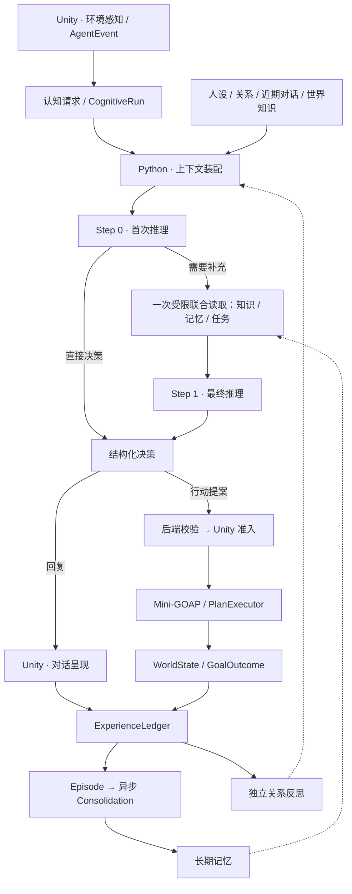

[简体中文](ARCHITECTURE.md) | [English](ARCHITECTURE.en.md)

# EmbodiedNPC 系统架构

EmbodiedNPC 是一套以 Unity 为游戏世界、Python 为认知后端的 AI NPC 运行架构。目前使用四名 NPC 的咖啡馆场景进行演示。系统围绕 **环境感知 → 认知决策 → 行为执行 → 记忆反思** 协作，让对话、行动及真实世界结果能够影响后续交互。

## 总体结构

这里的箭头表达数据流与执行关系；检索、行动和记忆整理是按条件发生的路径。Unity 负责实时世界状态与行动结果，模型负责形成回复或受约束的行动提案。

## 1. 环境感知层

每个 NPC 维护独立的局部感知：视觉传感器周期扫描可见实体，结合距离、视角与遮挡判断；近距离和听觉感知补充附近实体与声音事件。观察结果更新 `PerceivedState`，并非每次刷新都触发模型调用。

玩家输入、挥手及世界变化被封装为 `AgentEvent`。事件路由按目标身份交付，兴趣评估决定忽略、记录或唤起认知。定向发言只由目标 NPC 接收为当前请求；附近角色的旁听经过独立感知链路。满足条件后，`AgentOrchestrator` 为角色启动一个前台 `CognitiveRun`。

## 2. 认知决策层

`CognitiveContextComposer` 从当前事件、感知、角色定义、行为模式、相关玩家和可用能力创建有界快照。后端再结合近期对话、关系摘要、系统规则与世界知识完成模型输入装配。

- **人设**：身份、背景、个性、说话风格及交流边界，可在游戏内修改。
- **世界知识**：按角色权限读取常驻背景并自动预检索相关条目；必要时可补充查询。
- **近期对话与关系**：分别承接当前话题、提供针对特定对象的交流印象。
- **长期记忆**：历史证据按需召回，和角色背景知识分别检索。
- **上下文预算**：`ContextBudgetAllocator` 为规则、正文、检索结果、输出和安全余量分配容量。新建 Main 配置默认 32K，可按模型实际情况调整。

普通对话采用**最多两次模型推理**。Step 0 可以直接决策，也可以发起一次 `CONTEXT_READ`，由后端分别读取知识、记忆和允许的任务信息；Step 1 接收补充结果后输出最终决策。

普通决策包括 `DIRECT_RESPONSE`、`NO_ACTION`、`ACTION_PROPOSAL`。运行时还支持面向特定系统事件的受限模式意图与自主行动意图，沿用相应身份、事件和能力检查。

## 3. 行为执行层

行动提案由后端验证动作 ID、绑定和允许的能力，再送回 Unity。Unity 根据当前场景实体、执行者、目标、世界状态与任务占用独立准入。

`GoalPlanRunner` 接收目标，`ActionCatalog` 与计划工厂提供动作及前置条件、效果，`Mini-GOAP` 搜索可行步骤，`PlanExecutor` 逐步执行。导航、拿取、递送、制作饮品及清洁台面等操作复用现有执行组件，包含超时、取消、资源预约与有限重规划。

例如 `prepare_drink` 的正式计划主要是 `WalkTo → PrepareDrink`。制作完成后，`WorldStateService` 提交饮品回执，Unity 发布 `GoalOutcome`。结果按原请求、执行者和提案追踪，后续对话与记忆可以引用这次真实执行。

### 日常行为与正式任务

NPC 有 Work、Rest、Leisure 等日常模式，模式的目标与行为倾向会进入下一次认知上下文。Unity 本地按模式调度走动、擦拭、饮用等低优先级环境活动；正式任务通过准入后接管导航与交互控制权。

**行为模式与正式任务相互独立**：处于 Rest 的薇薇仍可执行经授权的制作请求，也可以由认知提出合规的模式切换意图，最终由 Unity 校验并提交。

## 4. 记忆反思层

已呈现的对话、可信观察和行动结果先写入角色自己的追加式 `ExperienceLedger`。连续经历按语义边界及时间、数量等规则分成 `Episode`；片段关闭后，后台异步整理为事件记忆和有来源的语义事实。

低频维护负责比较事实的重复、细化、更新和冲突；跨 Episode 反思形成有证据关联的暂定洞察。关系反思独立按 **NPC 持久身份 × 对象持久身份** 维护交流偏好与社会印象。

长期记忆使用向量与词法检索，按当前角色、主体和证据范围选取候选，随后在认知时通过一次受限读取提供相关历史。关系摘要作为独立的上下文内容提供。详细实现参见 [记忆系统](MEMORY.md)。

## 5. 前后台并发与模型配置

多个 NPC 的前台推理与 Episode 整理、关系反思、记忆维护共享有界模型执行器，采用前台优先、后台公平的调度方式。云端默认上限为 **总并发 6 / 前台 6 / 后台 2**，本地 Ollama 默认 **1 / 1 / 1**；三个值是共享容量约束，不能直接相加。

主模型与 Embedding 可分别配置；支持 DeepSeek、OpenAI 兼容接口、Gemini、Anthropic、Ollama 等适配器。设置经保存、应用及必要的后端重启生效。配置说明参见 [Backend](../AIBackend/README.md) 和 [源码运行](SOURCE_SETUP.md)。

## 6. 设置、扩展与当前范围

- **角色配置**：通过 Unity 页面修改 NPC 人设；新的认知请求使用更新后的配置。
- **世界知识**：支持搜索、编辑、权限控制、JSON 导入导出和默认条目恢复。
- **持久任务**：可保存部分未来委托，在再次来访或空闲机会中考虑执行，并根据世界回执结算。详见 [任务系统](NPC_TASK_SYSTEM.md)。
- **表现层**：对话气泡、表情、眼神、肢体表现与动作通道协调，与认知事实和世界执行分别管理。
- **迁移到其他场景**：保留认知和记忆核心，针对新游戏适配世界实体、感知事件、可用动作和呈现层。

当前公开演示面向单机咖啡馆。后续重点继续改进自然交流、长期关系、日常自主活动及场景复用。

## 相关文档

[记忆系统](MEMORY.md) · [世界知识](../AIBackend/WORLD_KNOWLEDGE.md) · [通信协议](../Contracts/README.md) · [源码运行](SOURCE_SETUP.md) · [贡献指南](../CONTRIBUTING.md)
