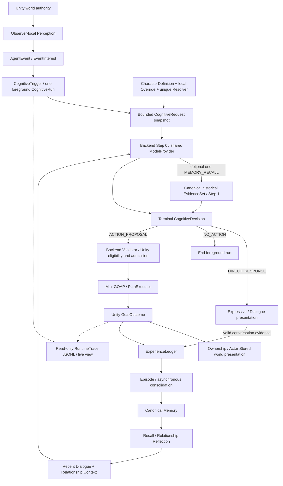

# EmbodiedNPC Architecture

This Early Prototype uses TitleScene → CafeDemoV2. This page explains the Unity/Backend authority boundaries and foundational Runtime flow. See [release scope](RELEASE_STATUS.md) for the retained source and validation limits, and [source setup](SOURCE_SETUP.md) to run the project.

## Runtime flow

## 1. Unity authority and identity

Unity owns WorldEntity/EntityRegistry, world state, navigation, action admission, execution, cancellation and final success/failure. Model output is an untrusted proposal. `definition_id` describes content, `entity_id` identifies a current instance, and trusted persistent identity provides Memory/Relationship continuity. Display names are not identity keys. Cafe currently has one local Player.

## 2. Perception and events

Vision/proximity and PerceivedState are observer-local; the model does not receive the entire registry. AgentEvent records an actual occurrence; EventInterest may wake cognition. Waking a run does not grant permission to initiate a world action. Player Wave is emitted after the animation starts and only reaches observers currently seeing the player.

## 3. CognitiveRun and bounded context

AgentOrchestrator owns one foreground CognitiveRun per NPC. CognitiveContextComposer creates a bounded request snapshot from trigger/current event, character, behavior mode, relevant Player, observer-local perception and current capabilities. Settings edits affect new requests, not previously built snapshots. There is no generic unrestricted Tool Loop or autonomous Goal/Plan Drive.

## 4. Character Persona v2 Lite

CharacterDefinition has exactly CharacterId, DisplayName, RoleSummary, Backstory, Personality, SpeakingStyle and Boundaries. ID is read-only (120 characters); the six editable limits are 80/240/600/600/480/600. Authoring, override store, DTO and Backend reject blank/oversized content; the Backend contract is frozen and rejects extra fields.

The unique CharacterProfileResolver combines built-in authoring defaults and local overrides. Override schema 1 preserves its three editable values and falls back to real defaults for the three new fields without writing; the next Save atomically writes complete schema 2. Save at defaults removes the entry; Restore removes only the selected entry and refreshes UI. Persona is untrusted low-authority JSON data: it influences stance, tone and wording, not capabilities, EntityRefs, current world/perception, historical evidence, relationship or Goal success.

## 5. Recent Dialogue

Recent dialogue is bounded, read-only conversation evidence. CurrentEvent remains the turn to answer. DialogueController keeps sessions when presentation is hidden. A non-conversation Wave response can be presented and traced but is not projected into dialogue_response persistence; this prevents an empty conversation from blocking later valid Dialogue ACKs.

## 6. Memory Recall

Backend Step 0 can request at most one MEMORY_RECALL; scoped canonical retrieval produces a bounded historical EvidenceSet for terminal Step 1. Repeated recall is rejected. Current world/perception takes precedence. There is no second language classifier or keyword routing that grants action authority. See [Memory](MEMORY.md).

## 7. Relationship Context

Pair-scoped RelationshipReflectionRecord derives subjective interpretation from evidence. A bounded on-read RelationshipSummary enters cognition without exposing persistent IDs. It can inform supported familiarity, but cannot establish exact history, present facts or action permission. Persistent Mood/CurrentAffect is not implemented.

## 8. Structured decisions

Ordinary CognitiveDecision uses DIRECT_RESPONSE, NO_ACTION or ACTION_PROPOSAL, with bounded presentation metadata emotion/gesture/look_at and optional episode_directive. The response decision union also admits restricted system-event DAILY_MODE_INTENT and AUTONOMOUS_ACTION_INTENT; their source and eligibility checks remain mandatory. Cognitive envelopes support 1.0 and task-aware 1.1, not a different version per decision kind. Internal MEMORY_RECALL and task read/mutation steps are adapted to terminal envelopes; they are not arbitrary Unity tools. See [Contracts](../Contracts/README.md). Recall is internal to Backend. A preference statement is not an action request; a spoken acknowledgment without a proposal does not execute anything.

## 9. Capabilities and action validation

The current Runtime manifest and Backend supported definitions bound action IDs, bindings, kinds, affordances and request-scoped entities. Backend ActionProposalValidator checks the proposal; Unity independently checks provenance, eligibility and current state. Validator acceptance is not proof of semantic permission or execution success. Cafe merchant's bounded service capabilities include `bring_object` and implemented drink-preparation interactions; exact current action definitions and scene eligibility must be checked in the manifests and Unity, not inferred from dialogue. Other NPCs do not gain staff actions through Persona.

## 10. Mini-GOAP and execution

GoalPlanRunner/ActionCatalog/ActionPlanFactory and PlanExecutor run deterministic WalkTo/PickUp/Carry/Give with reservations, timeout, cancellation and recovery. WorldStateService commits mutations and Unity publishes GoalOutcome. Give-to-Actor transfers ownership and hides Renderer/Collider/Perceivable while preserving entity/registry identity and HeldItemState. It does not implement Player Inventory, Equipment, Player Carry or general world-placement delivery.

## 11. Experience, Episode and canonical Memory

Accepted conversation and authoritative action evidence enter an append-only ExperienceLedger. Episode lifecycle combines semantic closure with deterministic limits and recovery. Asynchronous consolidation admits evidence-backed canonical records; migration 15 retires old physical Memory/Relationship tables while preserving migration definitions. Character background is not a player profile fact or shared-history evidence.

## 12. Expressive Runtime

Idle/Walk, Facing, Attention, Head Gaze, Talking, procedural Nod, KayKit Wave and NPC Carry are implemented; Player has locomotion and Wave. Presenters project bounded decision metadata and authoritative held state. Motion arbitration/presentation does not create world success. Facial Expression, LipSync and staged PickUp/HandOver animation are not implemented.

## 13. Default Routine

Merchant uses Engagement Hold and ReturnToHome after foreground/task/dialogue and busy state permit it. Formal tasks can preempt the routine's navigation. Home comes from startup pose; this is a low-priority fallback, not daily scheduling or autonomous planning. Focused tests and real bring/hold/return evidence exist; the old validation-blocked status no longer applies.

## 14. Settings and providers

Developer Panel has Overview, Model/API, NPC Character, World Knowledge, Debug and Runtime Trace. HTTP startup readiness and WebSocket startup recovery are implemented. Config checks open Model/API at each Play; missing configuration gates normal dialogue. Main adapters include Mock, Ollama, DeepSeek Official Responses, OpenAI-compatible, Gemini Native and Anthropic Native; adapter presence does not certify every remote model. Embedding has an independent slot.

Saved local Model Config takes precedence over environment bootstrap. Save changes the JSON; invocation-affecting values apply on Backend restart. Cognition, task failure, consolidation and relationship reflection share the startup Main provider/executor. Persona override edits apply on the next Run without restart. See [Operations](OPERATIONS.md).

World Knowledge K0/K1/K1.5 is implemented with Backend-owned data/access, independent Hybrid RAG and a protected local editor. Its developer reference never proves personal experience, current stock or action completion. Foreground cognition uses one allocator for whole Memory/Knowledge/Relationship evidence and the final Provider payload. The verified 16K/thinking-disabled cloud path is PASS WITH LIMITATIONS; the 2026-10-13 acceptance machine still had a saved 8K profile (historical snapshot; existing user settings are never silently migrated), small/unknown capacities stay conservative, and model Recall decisions remain imperfect. See [World Knowledge and budgets](../AIBackend/WORLD_KNOWLEDGE.md).

TaskService owns durable task status and attempt phase; Unity TaskExecutionBridge.stage only describes its local handshake. A reserved ticket, begin permission, world commit and successful settlement are separate facts. GameVisit binds the process session and stable Player identity; scene_instance_id invalidates old world attempts. Sync may reconcile lost-world/stale-condition records but never replays begin_execution. See [task system](NPC_TASK_SYSTEM.md).

## 15. RuntimeTrace and validation

JSONL is the single trace source. A live view projects the last 300 written lines with category/errors filter, pause/clear/autoscroll and folder access. Pause does not pause recording; Clear does not truncate the file. Trace is read-only and never Runtime authority.

Existing real DeepSeek Cafe E2E covers Dialogue, Wave followed immediately by Dialogue, and three fresh bring_object runs with accepted successful execution. Canonicalization has 71 targeted passing cases. Persona has separate targeted tests and a 10-call provider smoke. That was the historical post-Persona test status; newer staged-source Backend/Unity regression and Windows Standalone candidate builds exist, but full real-model Cafe/clean-machine release acceptance remains incomplete. See [current matrix](RELEASE_STATUS.md).

## Next and limitations

Standalone candidates and iterative UI tests now exist, but final recording/release acceptance is incomplete; see the current project plan. Facial Expression/Replaceable Character Visual is an optional display enhancement. PMX/VRM/Humanoid adapters remain possible future visual directions.

Not implemented as general systems: persistent Mood/decay, Motivation/Needs/Big Five, Narrative Graph, GraphRAG/automatic knowledge generation, Character Evolution, comprehensive Daily Schedule or long-term autonomous goals (limited daily modes/activities do exist), unrestricted Tool Loop, Facial/LipSync/TTS/ASR/VLM, Player Inventory UI/Equipment/Carry, generic runtime PMX/VRM mod loading, unrestricted world placement or large-scale multiplayer.
