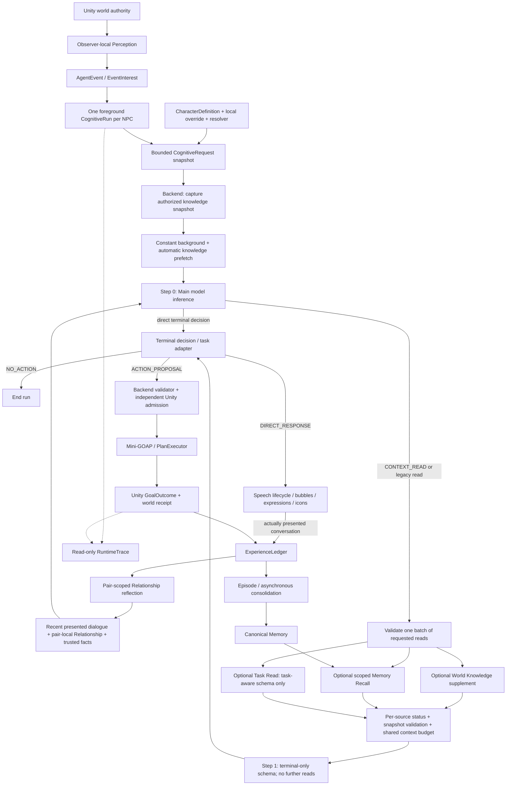

# EmbodiedNPC Architecture

The current v0.1.3-preview source uses TitleScene → CafeDemoV2. This page describes production module responsibilities and authority boundaries; it is not a claim that every provider or gameplay path has been tested. See [release scope](RELEASE_STATUS.md) for the retained source and validation limits, and [source setup](SOURCE_SETUP.md) to run the project.

## Runtime flow

This is the ordinary dialogue path. Fixed mode decisions, restricted action-feedback recovery, dialogue continuation and task-consideration events retain their own restricted schemas; the diagram does not grant them all dialogue reads or player action authority. A turn ends after Step 0 or Step 1: at most two model inferences, with no separate LLM query rewriter or third inference. Independent read branches can wait concurrently; shared Embedding provider gates still apply.

## 1. Unity authority and identity

Unity owns WorldEntity/EntityRegistry, world state, navigation, action admission, execution, cancellation and final success/failure. Model output is an untrusted proposal. `definition_id` describes content, `entity_id` identifies a current instance, and trusted persistent identity provides Memory/Relationship continuity. Display names are not identity keys. Cafe currently has one local Player.

## 2. Perception and events

Vision/proximity and PerceivedState are observer-local; the model does not receive the entire registry. AgentEvent records an actual occurrence; EventInterest may wake cognition. Waking a run does not grant permission to initiate a world action. Player Wave is emitted after the animation starts and only reaches observers currently seeing the player.

## 3. CognitiveRun and bounded context

AgentOrchestrator owns one foreground CognitiveRun per NPC. CognitiveContextComposer creates a bounded request snapshot from trigger/current event, character, behavior mode, relevant Player, observer-local perception and current capabilities. Persona/settings edits affect new requests, not previously built snapshots. Knowledge reads within a run use one captured catalog; a catalog change or unreadable catalog is detected before evidence reuse and before releasing a knowledge-grounded result, rather than silently mixing versions. There is no generic unrestricted Tool Loop or autonomous Goal/Plan Drive.

## 4. Character Persona v2 Lite

CharacterDefinition has exactly CharacterId, DisplayName, RoleSummary, Backstory, Personality, SpeakingStyle and Boundaries. ID is read-only (120 characters); the six editable limits are 80/240/600/600/480/600. Authoring, override store, DTO and Backend reject blank/oversized content; the Backend contract is frozen and rejects extra fields.

The unique CharacterProfileResolver combines built-in authoring defaults and local overrides. Override schema 1 preserves its three editable values and falls back to real defaults for the three new fields without writing; the next Save atomically writes complete schema 2. Save at defaults removes the entry; Restore removes only the selected entry and refreshes UI. Persona is untrusted low-authority JSON data: it influences stance, tone and wording, not capabilities, EntityRefs, current world/perception, historical evidence, relationship or Goal success.

## 5. Recent Dialogue

Recent dialogue is bounded, read-only conversation evidence. CurrentEvent remains the turn to answer. DialogueController keeps sessions when presentation is hidden. A non-conversation Wave response can be presented and traced but is not projected into dialogue_response persistence; this prevents an empty conversation from blocking later valid Dialogue ACKs.

## 6. Hybrid context reads

Before ordinary dialogue Step 0, [WorldKnowledgeResolver](../AIBackend/app/world_knowledge_store.py) captures the authorized complete catalog, assembles `constant` background and automatically retrieves relevant `retrieval` knowledge. The query normally uses current player text; short follow-ups may include the nearest current-session dialogue topic. Automatic prefetch requires lexical topic support in names/keywords after hybrid ranking; an explicit model supplement can retrieve additional semantic matches.

Step 0 may answer directly or request `CONTEXT_READ` with a `knowledge_plan`, `memory_plan`, and, in the task-aware schema, `task_plan`. At least one plan is required. Legacy `MEMORY_RECALL` and `TASK_READ` remain accepted. Backend executes one read batch, preserves each source's unavailable/no-match/budget status, and builds terminal Step 1 using an explicit phase. A failed source does not erase another source's valid result or prove a fact absent. Step 1 cannot request another read.

Automatic and supplementary knowledge together expose at most three distinct retrieval IDs; constants are deduplicated separately and do not occupy Top-K or require Embedding. Permission, deployment/scene scope, persistent identity and budgets are trusted Backend inputs, not model choices. Memory remains a separate historical retriever; `shared` is pair-evidence qualification, not a global memory scope. See [Memory](MEMORY.md), [World Knowledge](../AIBackend/WORLD_KNOWLEDGE.md) and [internal contracts](../Contracts/README.md#backend-internal-context-reads).

## 7. Relationship Context

Pair-scoped RelationshipReflectionRecord derives subjective interpretation from evidence. A bounded on-read RelationshipSummary enters cognition without exposing persistent IDs. It can inform supported familiarity, but cannot establish exact history, present facts or action permission. Persistent Mood/CurrentAffect is not implemented.

## 8. Structured decisions

Ordinary CognitiveDecision uses DIRECT_RESPONSE, NO_ACTION or ACTION_PROPOSAL, with bounded presentation metadata `emotion` / `gesture` / `look_at`, optional `expression_icon`, and optional `episode_directive`. The response decision union also admits restricted system-event DAILY_MODE_INTENT and AUTONOMOUS_ACTION_INTENT; their source and eligibility checks remain mandatory. Cognitive envelopes support 1.0 and task-aware 1.1, not a different version per decision kind. Internal CONTEXT_READ, legacy MEMORY_RECALL/TASK_READ and task mutation steps are adapted to terminal envelopes; they are not arbitrary Unity tools. See [Contracts](../Contracts/README.md). Recall is internal to Backend. A preference statement is not an action request; a spoken acknowledgment without a proposal does not execute anything.

## 9. Capabilities and action validation

The current Runtime manifest and Backend supported definitions bound action IDs, bindings, kinds, affordances and request-scoped entities. Backend ActionProposalValidator checks the proposal; Unity independently checks provenance, eligibility and current state. Validator acceptance is not proof of semantic permission or execution success. Cafe merchant's bounded service capabilities include `bring_object`, `prepare_drink` and `clean_counter`; current bindings and scene eligibility are checked in the manifests and Unity, not inferred from dialogue. Other NPCs do not gain staff actions through Persona.

The ten hot-drink IDs are `latte`, `cappuccino`, `americano`, `espresso`, `flat_white`, `mocha`, `caramel_macchiato`, `hot_chocolate`, `matcha_latte` and `black_tea`. Backend contracts, task goals, action metadata and historical-result validation reuse [DrinkType](../AIBackend/app/drink_types.py). Unity maintains IDs and bilingual display names in [DrinkTypes](../UnityClient/Assets/Scripts/Actions/PrepareDrinkAction.cs); its manifest derives the same ordered values. They share one preparation flow, animation, duration and receipt semantics. Knowledge descriptions do not grant preparation capability or create a second menu/recipe authority.

## 10. Mini-GOAP and execution

GoalPlanRunner/ActionCatalog/ActionPlanFactory and PlanExecutor run deterministic WalkTo/PickUp/Carry/Give with reservations, timeout, cancellation and recovery. WorldStateService commits mutations and Unity publishes GoalOutcome. Give-to-Actor transfers ownership and hides Renderer/Collider/Perceivable while preserving entity/registry identity and HeldItemState. It does not implement Player Inventory, Equipment, Player Carry or general world-placement delivery.

## 11. Experience, Episode and canonical Memory

Accepted conversation and authoritative action evidence enter an append-only ExperienceLedger. Episode lifecycle combines semantic closure with deterministic limits and recovery. Asynchronous consolidation admits evidence-backed canonical records; migration 15 retires old physical Memory/Relationship tables while preserving migration definitions. Character background is not a player profile fact or shared-history evidence.

## 12. Expressive Runtime and player appearance

[ExpressiveController](../UnityClient/Assets/Scripts/Animation/ExpressiveController.cs) associates accepted metadata with the owning NPC and actual [SpeechPresentationLifecycle](../UnityClient/Assets/Scripts/Dialogue/Presentation/SpeechPresentationLifecycle.cs). [DialogueAnimationPresenter](../UnityClient/Assets/Scripts/Animation/DialogueAnimationPresenter.cs) adds low-priority, arms-only speech accents with phrase/rest intervals; serialized strengths and timing allow character differences. Gesture, facing and [HeadGazeController](../UnityClient/Assets/Scripts/Animation/HeadGazeController.cs) work under [MotionChannelCoordinator](../UnityClient/Assets/Scripts/Animation/MotionChannelCoordinator.cs). Walking, carrying and formal task/action motion retain priority. Ending or replacing speech clears presentation rather than creating action success.

[CafeVrmExpressionPresenter](../UnityClient/Assets/CafeDemo/Scripts/CafeVrmExpressionPresenter.cs) blends supported VRM blink/happy/relaxed/sad/surprised presets, with subtle tone-dependent weights and transitions. Missing or incompatible bindings degrade gracefully; models do not all support the same visible expressions. This is facial presentation, not audio-driven LipSync.

[DialogueEmotionIconPresenter](../UnityClient/Assets/Scripts/Dialogue/Presentation/DialogueEmotionIconPresenter.cs) displays optional `expression_icon` hints: happy (♪), confused (?), surprised (!) and thinking (…). Null/`none` is the normal default; punctuation alone does not select an icon. A valid cue is shown only for its NPC's active presented speech/session, with a per-NPC cooldown (default 18 seconds), a short fade/float (default 1.35 seconds) and stable placement beside the head. Reply replacement, speech end, session change and disable clean it up. Icons are cosmetic, not Memory or world events.

Player locomotion and Wave remain separate. [PlayerVrmAppearance](../UnityClient/Assets/CafeDemo/Scripts/PlayerVrmAppearance.cs) imports a local VRM into the player's visual wrapper using UniVRM, checks eligibility and model compatibility, and preserves the actor root, identity, collision, camera, cognition and task/action bindings. It supports rollback/default appearance; it is not unrestricted NPC/model mod loading. Procedural speech motion and text bubbles do not imply TTS, ASR, general audio LipSync, or staged PickUp/HandOver animation.

## 13. Default Routine

Merchant uses Engagement Hold and ReturnToHome after foreground/task/dialogue and busy state permit it. Formal tasks can preempt the routine's navigation. Home comes from startup pose; this is a low-priority fallback, not daily scheduling or autonomous planning. Focused tests and real bring/hold/return evidence exist; the old validation-blocked status no longer applies.

## 14. Settings and providers

Developer Panel has Overview, Model/API, NPC Character, World Knowledge, Debug and Runtime Trace. HTTP startup readiness and WebSocket startup recovery are implemented. Config checks open Model/API at each Play; missing configuration gates normal dialogue. Main adapters include Mock, Ollama, DeepSeek Official Responses, OpenAI-compatible, Gemini Native and Anthropic Native; adapter presence does not certify every remote model. Embedding has an independent slot.

Saved local Model Config takes precedence over environment bootstrap. Save changes the JSON; invocation-affecting values apply on Backend restart. Cognition, task failure, consolidation and relationship reflection share the startup Main provider/executor. Persona override edits apply on the next Run without restart. See [Operations](OPERATIONS.md).

### World Knowledge management and context budgets

[WorldKnowledgeStore](../AIBackend/app/world_knowledge_store.py) owns a complete player JSON catalog (`schema_version=2`). The 108-entry system template is read-only, used for initialization, explicit legacy migration or restore; installed template updates never merge into an existing player catalog. Backend enforces `public`/`restricted` CharacterId access plus trusted deployment/scene binding. `constant` background and `retrieval` knowledge remain low-authority reference data, not actual player experience, current stock or action completion.

[CafeWorldKnowledgePanel](../UnityClient/Assets/CafeDemo/Scripts/CafeWorldKnowledgePanel.cs) uses [KnowledgeManagementClient](../UnityClient/Assets/Scripts/Settings/KnowledgeManagementClient.cs) and the existing [management API](../AIBackend/app/knowledge_management_api.py) for search/filter/edit, complete JSON export, import preview/confirmation, and single-entry or whole-template restore. Import replaces the catalog; stale previews fail local revision checks. Cross-process locking, backup and atomic writes protect modifications. The SQLite [knowledge index](../AIBackend/app/knowledge_embeddings.py) is derived: only the actual embedding projection changes its content fingerprint, not ACL/usage/source bookkeeping. Constant entries need no vector; lexical fallback remains available.

Step 0/1 use one [ContextBudgetAllocator](../AIBackend/app/context_budget_allocator.py) policy for the final provider payload, including schema, output/safety reserves, whole Memory evidence, knowledge, dialogue, Relationship and Task context. Constants count toward the mandatory budget and fail explicitly with `CONSTANT_KNOWLEDGE_BUDGET_EXCEEDED` if they cannot fit intact. New Main profiles default to 32768 tokens via [provider presets](../AIBackend/app/model_provider_presets.py); this is a requested budget, not a provider capacity guarantee. Saved explicit capacities remain unchanged; unknown capacity falls back conservatively to 8192 in the entry point, and a smaller declared provider capacity limits the effective window. Earlier 8K/16K acceptance profiles are historical evidence, not today's universal setting.

### Read-only complete experience export

Settings → General & controls → Support & diagnostics offers an explicitly confirmed local ZIP export. [ExperienceDataExport](../UnityClient/Assets/CafeDemo/Scripts/ExperienceDataExport.cs) combines loaded default/override/effective Personas, saved player settings/avatar metadata, and existing sanitized [DiagnosticsExport](../UnityClient/Assets/Scripts/Settings/DiagnosticsExport.cs) output with the authenticated local [Backend exporter](../AIBackend/app/experience_export.py) (`GET /v1/experience-export`). It is a read model over existing stores, never another source of truth or a trigger for consolidation, reflection, migration or model calls.

Backend reads retained current-player Experience, displayed conversations, Episodes, canonical Memory/source links, Relationship and Task/Action records in one read-only SQLite transaction that includes committed WAL data. It exports current knowledge as a separate revisioned snapshot; Unity settings are separately captured too, so the ZIP is not a single cross-system transaction. Identity/evidence filters exclude foreign or unbound private records; missing categories and partially scoped Episodes are reported in manifests, not invented. Task promises, action proposals and unpresented replies are not promoted to completed actions or displayed dialogue.

The ZIP contains `manifest.json`, `npc_personas.json`, `player_profile.json`, `world_knowledge.json`, `experiences.jsonl`, `conversations.jsonl`/`.md`, `episodes.json`, `memories.json`, `relationships.json`, `tasks.json`, `actions.json`, Backend/projection metadata and `diagnostics/` as available. No raw live SQLite/WAL files, credentials, weights or avatar binary are bundled. It preserves authored chat/knowledge text, which may contain personal information; sharing is voluntary and nothing uploads automatically. Resource limits fail rather than silently trim records; partial availability is reported, and failed archive construction does not publish a complete ZIP.

### Persistent tasks

TaskService owns durable task status and attempt phase; Unity TaskExecutionBridge.stage only describes its local handshake. A reserved ticket, begin permission, world commit and successful settlement are separate facts. GameVisit binds the process session and stable Player identity; scene_instance_id invalidates old world attempts. Sync may reconcile lost-world/stale-condition records but never replays begin_execution. See [task system](NPC_TASK_SYSTEM.md).

## 15. RuntimeTrace and validation

JSONL is the single trace source. A live view projects the last 300 written lines with category/errors filter, pause/clear/autoscroll and folder access. Pause does not pause recording; Clear does not truncate the file. Trace is read-only and never Runtime authority.

Validation records are version-specific. Earlier bring_object/Persona/M3 reports describe their own commits and environments, not the full current feature set. v0.1.3-preview includes the hybrid cognition, knowledge editor, presentation and export paths described here. Published artifact build/startup/export/restart checks belong to the [release notes](https://github.com/LYFshota/EmbodiedNPC/releases/tag/v0.1.3-preview); [release scope](RELEASE_STATUS.md) separates historical checks from current source. This documentation refresh runs no new gameplay/model validation.

## Next and limitations

VRM facial expressions, local player VRM import and Windows preview packages are implemented; their presence is not a guarantee of identical visuals across models or clean-machine certification. History/source safeguards reduce unsupported claims but do not prove model semantic correctness.

Not implemented as general systems: persistent Mood/decay, Motivation/Needs/Big Five, Narrative Graph, GraphRAG/automatic knowledge generation, Character Evolution, comprehensive Daily Schedule or long-term autonomous goals (limited daily modes/activities do exist), unrestricted Tool Loop, audio-driven LipSync/TTS/ASR/VLM, Player Inventory UI/Equipment/Carry, generic runtime PMX/NPC mod loading, unrestricted world placement or large-scale multiplayer.
