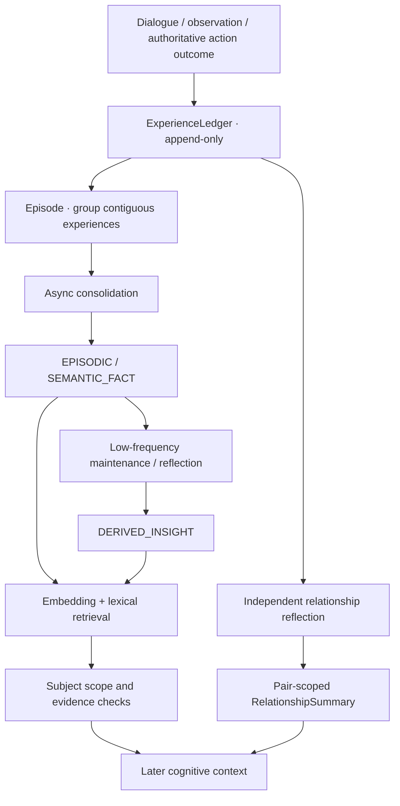

[简体中文](MEMORY.md) | [English](MEMORY.en.md)

# EmbodiedNPC Memory and Relationships

Memory preserves what NPCs **actually experienced** as durable, source-linked information and retrieves relevant history for later cognition. Raw experience, episodic memories, semantic facts, cross-Episode insights, and relationships have separate responsibilities. Conversations do not simply accumulate into an ever-growing prompt.

## Runtime flow

Consolidation and relationship reflection run in the background according to their own triggers; normal dialogue does not wait for every maintenance job.

## 1. ExperienceLedger

Presented speech, observer-qualified events and trusted Unity action results enter each NPC's append-only ExperienceLedger. Records retain event links, observer identity, participants and provenance. The original evidence can be replayed or used to rebuild derived memory.

Three sources must be kept distinct: **World** is what Unity currently confirms, **Experience** is what a particular NPC actually encountered, and **Persona / World Knowledge** is authored character or setting information.

## 2. Episode segmentation

Contiguous Experience from one observer forms an Episode. A cognitive result may suggest `CONTINUE` or `END` as a semantic boundary. Session lifecycle, idle timeout, maximum events, maximum duration and recovery rules also govern closure.

Episodes reference ranges of original Experience; they do not store another copy of dialogue and actions. Closed Episodes become eligible for background consolidation.

## 3. Consolidation

The Backend rebuilds a finalized Episode from its exact source range, combining character context, participant identities and relevant existing memories in one structured consolidation call. Evidence and identity checks gate admission of:

- **EPISODIC** memories, representing a specific event, conversation or action.
- **SEMANTIC_FACT** records, representing individual sourced claims, such as a player-stated drink preference.

The raw ledger remains intact. Consolidation uses the background executor while foreground conversation proceeds separately.

## 4. Maintenance and cross-Episode reflection

`Maintenance` compares related facts and records duplicates, refinements, coexistence, supersession or conflicts. A genuine preference change is tied to evidence; conflicts may remain visible instead of choosing the newest claim automatically.

`Reflection` periodically evaluates information across multiple Episodes to propose **DERIVED_INSIGHT**, a tentative interpretation with links to original evidence. This is a separate background step rather than a guaranteed output of every Episode.

## 5. Pair-scoped relationships

Relationship state is keyed by **(observer persistent identity, subject persistent identity)**. Vivi's understanding of Xingmang is separate from another NPC's understanding of Xingmang, and from Vivi's relationship with another player.

Relationship reflection draws on qualified social Experience to maintain communication styles, boundaries and social impressions. A bounded `RelationshipSummary` can inform later cognition. Specific past events still come from Memory Recall and their evidence, rather than from an impression summary.

The current demo runs with one local player; persistent identities and pair scoping provide a useful foundation for future extensions.

## 6. Retrieval and identity

Memory has its own Embedding index and ranks with lexical relevance, memory type, authorized identity and evidence. World Knowledge is retrieved separately.

In ordinary dialogue, Step 0 can request one `CONTEXT_READ` batch. Its `memory_plan` specifies the topic and an allowed subject role:

| Role | Scope |
| --- | --- |
| `requester` | The current trusted player's statements, preferences or experiences |
| `observer` | This NPC's own history |
| `shared` | Evidence involving both this NPC and the current player, qualified from original Ledger records |
| `catalog` | Another currently authorized subject selected through the catalog |

The Backend resolves these semantic roles to trusted persistent identities, returns bounded sourced candidates and fits the result into the shared context budget for terminal Step 1.

Lexical fallback is available while vectors are pending. Missing evidence, identity or provenance remains explicit rather than becoming a guessed historical fact.

## 7. Interpreting evidence

- **NPC speech** records what was actually said; claiming it was shown to a specific player also requires delivery evidence.
- **Player preferences** can become sourced Semantic Facts with identity, time and original statement references.
- **Action proposals and promises** record intent. A completed action needs a matching Unity `GoalOutcome` or world receipt.
- **Current world state** comes from Unity; memory offers historical context rather than replacing current observation.

## 8. Storage, budgeting and export

Canonical storage uses `memory_records`, `memory_subjects`, `memory_evidence`, `memory_semantic_facts`, `memory_derived_insights` and `memory_embeddings`. Migrations remain in source history, while current reads use canonical Memory.

Recall is bounded by authorized identities, relevance and available context space. New Main configurations default to a 32K request budget with output and safety reserves. The settings UI also supports read-only experience export for inspecting retained evidence and memory links.

## Related documents

[Architecture](ARCHITECTURE.en.md) · [World Knowledge](../AIBackend/WORLD_KNOWLEDGE.md) · [Contracts](../Contracts/README.md) · [Persistent Tasks](NPC_TASK_SYSTEM.md)
