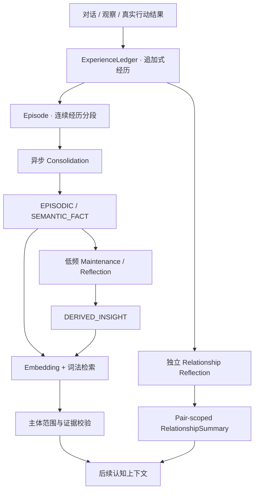

[简体中文](MEMORY.md) | [English](MEMORY.en.md)

# EmbodiedNPC 记忆与关系系统

记忆系统负责把 NPC **实际经历的事情**保存为有来源的长期信息，并在后续认知中按需要召回。它分开管理原始经历、事件记忆、语义事实、跨经历洞察和角色关系，不把聊天记录简单拼接成无限增长的提示词。

## 整体流程

记忆整理与关系反思在后台按各自条件运行；日常对话不必等待全部整理完成。

## 1. 原始经历：ExperienceLedger

Unity 已呈现的对话、可归属的观察和可信行动结果写入各 NPC 自己的经历账本，保留事件关联、观察者、参与者和来源信息。账本采用追加式记录，长期记忆可以由这些来源重新整理。

**世界状态、经历和角色设定是三种不同的信息**：Unity 提供当下真实状态；Experience 保存角色实际遇到的事件；Persona 与 World Knowledge 提供预设身份和背景知识。

## 2. Episode：把连续经历分段

同一观察者连续的 Experience 组成 Episode。认知结果可以附带 `CONTINUE` / `END` 语义分段建议；实际生命周期还受会话结束、空闲时间、事件数量、最长持续时间和重启恢复等规则约束。

Episode 记录来源区间与分段状态，不复制第二套对话或行动历史。关闭后即可交给后台整理。

## 3. Consolidation：从经历提取长期记忆

已关闭的 Episode 根据准确的 Experience 范围重建，结合角色信息、参与者身份及相关历史记忆，进行一次结构化整理。后端核验来源和数据关联后，保存两种主要记忆：

- **EPISODIC**：某次实际发生的事件、交流或行动。
- **SEMANTIC_FACT**：有来源依据的独立事实，例如玩家明确表达过的饮品偏好。

原始账本仍然保留。整理任务通过后台执行器处理，与玩家前台对话并发调度。

## 4. 低频维护与跨经历反思

`Maintenance` 比较相关事实之间的关系，包括重复、细化、共存、取代与冲突。明确的偏好变化需要有对应证据；存在冲突时可保留双方记录，而不是只凭时间先后选一条。

`Reflection` 在积累多段 Episode 后，尝试形成 **DERIVED_INSIGHT**，也就是引用多段经历的暂定洞察。它与一段 Episode 的普通 Consolidation 是不同的后台任务；洞察带有来源关联和不确定性。

## 5. 独立关系：Relationship Reflection

角色关系使用 **（观察者持久身份，对象持久身份）** 作为配对范围。薇薇与星芒的关系、沈知意与星芒的关系，以及薇薇与另一位玩家的关系分别维护。

关系反思根据符合来源条件的社交经历维护交流习惯、边界与社会印象。它主要描述角色如何理解双方相处方式，而不是复制所有具体事实或委托。认知阶段可读取有界的 `RelationshipSummary`；需要核对过去某件事时，仍由 Memory Recall 提供原始证据。

当前 Demo 是本地单玩家运行，持久身份与配对隔离为后续扩展保留了基础。

## 6. 索引与受限召回

记忆建立独立的 Embedding 索引，并结合词法相关性、记忆类型、身份范围和证据进行排序。世界知识使用另一套检索器。

普通认知先获取必要的角色背景与自动预取的世界知识。Step 0 如需历史信息，可请求一次 `CONTEXT_READ`，其中 `memory_plan` 说明查询主题及主体角色：

| 主体角色 | 含义 |
| --- | --- |
| `requester` | 当前可信玩家的陈述、偏好或经历 |
| `observer` | 当前 NPC 自己的历史 |
| `shared` | 进一步由原始经历核验、涉及当前 NPC 与玩家双方的证据 |
| `catalog` | 当前授权目录中的其他主体 |

Backend 将这些语义角色解析成可信持久身份，再读取有限候选和来源。读取结果与其他上下文共同经过 Token 预算后进入 Step 1；第二次推理直接作出最终决策。

向量索引暂未就绪时可以使用词法回退；无法确认来源、主体或具体历史时，系统保留未知状态，不把它改写成确定事实。

## 7. 记忆与世界结果的关系

- **NPC 实际说过的话**：能够作为对应的发言经历；是否确实呈现给某位玩家，还需要原始展示证据。
- **玩家表达的偏好**：可以形成语义事实，保留对象、时间和原话来源。
- **行动提案与承诺**：记录的是意图；真实完成需要匹配 Unity 的 `GoalOutcome` 或世界回执。
- **当前世界状态**：优先参考 Unity 实时感知；历史记忆用于提供背景，不覆盖当下环境。

## 8. 数据、预算与导出

长期记忆由 `memory_records`、`memory_subjects`、`memory_evidence`、`memory_semantic_facts`、`memory_derived_insights` 和 `memory_embeddings` 等数据结构管理。历史表迁移保留在代码中，当前读取统一使用 canonical Memory。

召回由当前身份、相关性和剩余上下文容量限定。新建 Main 模型配置默认 32K 预算，实际还需为输出和安全余量留空间。游戏设置支持只读体验数据导出，便于玩家查看经历和记忆来源。

## 相关资料

[整体架构](ARCHITECTURE.md) · [世界知识](../AIBackend/WORLD_KNOWLEDGE.md) · [认知协议](../Contracts/README.md) · [持久任务](NPC_TASK_SYSTEM.md)
