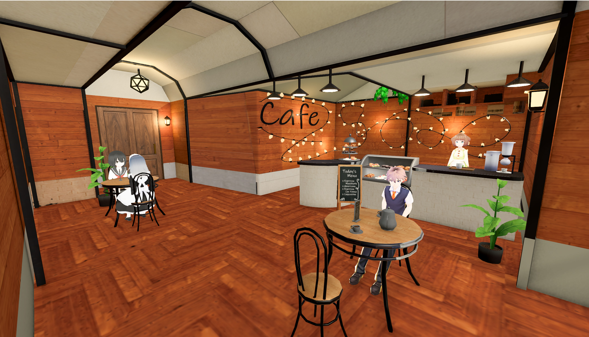
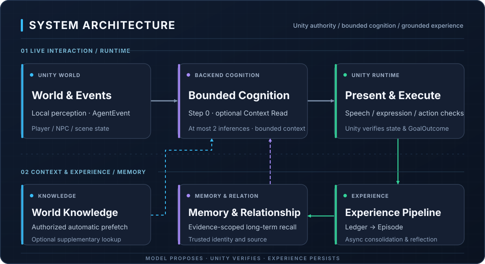

[简体中文](README.md) | English

# ☕ EmbodiedNPC

**Game NPCs that do more than respond — they remember players, perceive their surroundings, and take action.**

Unity 6 · Python / FastAPI · AI Agents · Long-term Memory · Local / Cloud LLMs

EmbodiedNPC is an open-source exploration of **persistent NPC interactions and autonomous behavior in games**. Its current single-player café demo features four characters — Vivi, Shen Zhiyi, Wen Yu'an, and Jiang Yizhou — with distinct personalities. Talk with them, revisit shared experiences, ask the barista to prepare drinks or serve snacks, and watch the characters go about their day.

At its core is a working loop: **perception → cognition → memory / action → world feedback → the next interaction**.

<p align="center">
  
</p>

## ✨ Features

- **Character-driven conversations:** Four NPCs with distinct backgrounds, personalities and speaking styles. Conversations support Chinese and English and can pick up on recent context.
- **Long-term memory and relationships:** Conversations and actual actions become experiences that feed background Episode processing, long-term memory, and evolving character relationships.
- **World knowledge:** 161 built-in entries about the café, characters and neighborhood. Knowledge can be scoped per NPC, searched, edited, imported and exported.
- **Perception and world actions:** NPCs use local context and their abilities to propose actions. Unity validates and performs drink preparation, counter cleaning, item delivery, and snack service, then reports the outcome.
- **Persistent tasks:** Some future requests and arrangements can be remembered, revisited, rescheduled or cancelled.
- **Everyday animation:** Vivi moves, pauses and wipes behind the counter. Wen and Jiang occasionally pick up their cups. The player has a subtle idle smile and expressions tied to actions.
- **Concurrency and model choices:** Bounded concurrent foreground and background work across NPCs, with separate configuration for the Main LLM, embeddings and runtime settings.

### Latest release: v0.1.5-preview

This update adds **everyday NPC activities, snack service, player expression blending, and Left Alt cursor control**, alongside memory, relationship and interaction refinements.

Snack choices include croissants, macarons, cupcakes and pudding. Vivi approaches the appropriate display point for a short pickup animation and presents the service result. See [Releases](https://github.com/LYFshota/EmbodiedNPC/releases) for version details and validation records.

## 🎮 Download and play

**[Download the Windows x64 preview](https://github.com/LYFshota/EmbodiedNPC/releases/download/v0.1.5-preview/EmbodiedNPC-v0.1.5-preview-Windows-x64.zip)** · [v0.1.5-preview release notes](https://github.com/LYFshota/EmbodiedNPC/releases/tag/v0.1.5-preview)

1. Extract the ZIP and run `Start.cmd`. Unity Editor and a separate Python installation are not required.
2. Configure your own Main LLM in Settings, using a compatible cloud API or local model service.
3. Enter the café to talk with NPCs, request services, or observe their everyday activities.

The preview includes **EmbeddingGemma-300M Q4 ONNX** for local memory embeddings. Bring your own chat model and API key if your provider requires one.

## 🧩 Architecture

<p align="center">
  
</p>

**Unity owns the world. The Python Backend handles cognition. Memory and action outcomes connect successive interactions.**

- **Perception and events:** Unity captures relevant events from the scene, player interactions, and nearby characters.
- **Cognition and context:** The Backend combines persona, recent dialogue, world knowledge, memory and relationship information to produce responses or action proposals, with optional additional context reads.
- **Action and feedback:** Unity validates and executes formal actions, returning outcomes for cognition and experience records. Everyday animations are driven locally by Unity's behavior layer.
- **Long-term memory:** Episodes are consolidated and recalled asynchronously; relationship reflections are maintained separately to support interactions across sessions.
- **Concurrent work:** Model calls for different NPCs and background jobs can run in parallel while preserving per-character and data-scope constraints.

For implementation details, see [Architecture](Docs/ARCHITECTURE.md), [Memory](Docs/MEMORY.md), and [Communication Contracts](Contracts/README.md).

## 🛠️ Run from source

Development environment: **Unity 6000.5.10f1, Python 3.12 x64, Git, Windows**.

1. Clone the repository. From the `AIBackend` directory, create a Python environment, install dependencies and start the service:

   ```powershell
   cd AIBackend
   py -3.12 -m venv .venv
   .\.venv\Scripts\python.exe -m pip install -r requirements.txt
   .\.venv\Scripts\python.exe -m uvicorn app.main:app --host 127.0.0.1 --port 8000 --no-proxy-headers
   ```

2. Open `UnityClient` in Unity Hub. After importing assets, run `Assets/Scenes/TitleScene.unity`.
3. Configure Main LLM and Embedding in game, save, and restart the Backend when prompted.

**Note:** Embedding weights are not stored in the source repository. Follow [Source Setup](Docs/SOURCE_SETUP.md) to prepare them, configure an external embedding provider, or disable vector search. The Windows preview already includes the local embedding resources.

## 📊 Model experiments

The project evaluated models against **100 fixed NPC scenarios** covering dialogue, memory and action decisions. These are project-specific results, not a general model benchmark.

| Model | Score |
| --- | ---: |
| GLM-5.3 Flash | **89 / 100** |
| Gemini 3.8 Flash | **88 / 100** |
| DeepSeek V4.1 Flash | **87 / 100** |
| Qwen3.8 Flash | 82 / 100 |
| Qwen3.8-27B W8A8 | 78 / 100 |
| Nemotron 3.5 BF16 | 66 / 100 |
| Qwen3.5-9B | 56 / 100 |
| Qwen3.5-4B | 39 / 100 |

## 📚 Documentation

| Topic | Docs |
| --- | --- |
| Architecture and data flow | [ARCHITECTURE](Docs/ARCHITECTURE.md) |
| Long-term memory | [MEMORY](Docs/MEMORY.md) |
| World knowledge and future tasks | [WORLD_KNOWLEDGE](AIBackend/WORLD_KNOWLEDGE.md) · [NPC_TASK_SYSTEM](Docs/NPC_TASK_SYSTEM.md) |
| Source setup and operations | [SOURCE_SETUP](Docs/SOURCE_SETUP.md) · [OPERATIONS](Docs/OPERATIONS.md) |
| Backend and Unity protocol | [Backend](AIBackend/README.md) · [Contracts](Contracts/README.md) |
| Contributing | [CONTRIBUTING](CONTRIBUTING.md) |

See the [documentation index](Docs/README.md) for more. Some technical documents are primarily in Chinese.

## 🌱 What's next

The focus is on **more natural conversations, relationships that develop over time, expressive nonverbal behavior, and richer interactions with the game world**, while making characters and scenes easier to configure and reuse.

Feedback, ideas and Pull Requests are welcome via [Issues](https://github.com/LYFshota/EmbodiedNPC/issues). You can also reach out at [952650555@qq.com](mailto:952650555@qq.com).

## 📄 License

Original project code and documentation are licensed under **Apache-2.0**. Third-party models, art, animation, fonts and other assets retain their own licenses. The player character **Xingmang** has a separate project-scoped non-commercial license.

See [LICENSE](LICENSE), [THIRD_PARTY_NOTICES](THIRD_PARTY_NOTICES.md), and the [Xingmang license](UnityClient/Assets/VRMCompatibilityTest/Xingmang.LICENSE.md).
