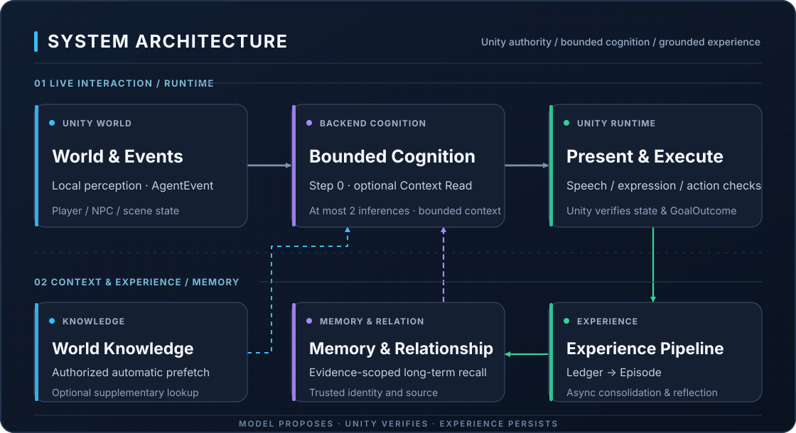

[简体中文](README.md) | English

# ☕ EmbodiedNPC

**Connecting game NPC dialogue to perception, memory and actions in the world.**

🚧 Early Prototype · Under active development

Unity 6 · Python / FastAPI · Long-term memory · Local / remote LLMs

EmbodiedNPC is an experimental multi-NPC cognition and interaction project for game scenes. The current **single-player café demo** has four NPCs with distinct personas. They can talk to the player; characters with the appropriate capabilities can deliver items, prepare drinks or clean counters.

The project explores a working loop: **perception → cognition → memory and action → world feedback → future interactions**. The model uses character experiences and local surroundings to propose replies or actions. Unity validates and executes them, and actual results become evidence for later interactions. NPC autonomy and available actions are limited; this is an early prototype, not a complete general-purpose Agent framework.

<p align="center">
  
</p>

## Download and try

[Download the Windows x64 preview ZIP](https://github.com/LYFshota/EmbodiedNPC/releases/download/v0.1.4-preview/EmbodiedNPC-Windows-x64-v0.1.4-preview.zip) · [Pre-release notes](https://github.com/LYFshota/EmbodiedNPC/releases/tag/v0.1.4-preview)

1. Extract the complete archive and run `Start.cmd`. No Unity Editor or separate Python installation is needed.
2. **Configure your own Main LLM** for dialogue and decisions. The ZIP bundles EmbeddingGemma-300M Q4 ONNX for memory vectors, so no extra Embedding download or API setup is normally needed. External Embedding and disabled-vector options remain available.
3. Personal settings and memories persist in the package-local `UserData`. Shut down normally and back it up before updating.

## What works today

- **Distinct character conversations:** Four NPCs have separate personas, personalities and dialogue styles, support Chinese and English, and use recent dialogue to continue topics.
- **Long-term memory and experience processing:** Actual conversations and action experiences are recorded, processed in the background and recalled on demand. Processing and recall can still fail.
- **World knowledge management:** Includes 156 entries covering coffee, characters and the neighborhood. Players can search, edit, add, import and export entries, and configure which NPCs know them and how they are used.
- **Local perception and overhearing:** NPCs perceive nearby surroundings and can record nearby text speech when range and occlusion permit. Overhearing does not automatically trigger an interruption.
- **Scene actions and feedback:** Characters with the appropriate capabilities can deliver items, prepare ten hot drinks and clean counters. The game validates and executes actions, then feeds actual results back into cognition and memory.
- **Persistent tasks and meeting arrangements:** Limited future requests can be saved for consideration at the next meeting or another suitable opportunity, deferred or cancelled. A saved arrangement is not proof of completion.
- **Expressions and dialogue motion:** Dialogue motions, expressions and conversational rhythms can vary by character, with occasional happy, confused, surprised and thinking icons.
- **Separate model configuration:** The main model and vector-retrieval model are configured independently, using local or remote services.
- **Experience data export:** Export retained conversations, memories, personas, knowledge, relationships, tasks and other data from Settings for personal records or feedback. Exports may contain personal information: review before sharing. The game does not upload them automatically.

### New in v0.1.4-preview

- **Everyday conversation:** 12 additional private backgrounds per NPC, bringing the default catalog to 156 entries. Guidance favors useful follow-ups over repeated stories, mechanical questions or unrelated sales pitches; actual wording still depends on the model.
- **Segmented replies:** Overhead bubbles and chat history share explicit paragraph boundaries, with at most three bubbles. The first overhead segment is immediate, later segments are two seconds apart, with a 20-second lifetime. History shows all segments immediately; storage retains one reply per turn.
- **Trusted historical outcomes:** While the original order remains in recent dialogue, its validated terminal outcome can accompany that dialogue. Historical completion remains separate from current task state; the general 900-second recent-results window is unchanged.
- **Bounded concurrency:** Cloud defaults to **6 total / 6 foreground / 2 background**; Ollama defaults to **1/1/1**. Use Settings > Developer tools > **Concurrency settings**, save/apply and restart. Independent NPC inference and background Episode, relationship and memory jobs can overlap while preserving required pair/scope ordering and shutdown safety.

Existing player-authored knowledge catalogs are not overwritten by new defaults. To adopt the expanded defaults, export a backup first, then explicitly restore system defaults in World knowledge; this replaces the current catalog.

## System architecture

<p align="center">
  
</p>

[Simplified Mermaid flow](Docs/Images/architecture-overview.en.mmd)

This is an overview of ordinary interaction. Replies, no action and action proposals are distinct outcomes; only action proposals enter action admission and execution. Background memory processing does not require every dialogue turn to wait for it.

- **Unity world authority:** Unity owns current world state, local perception, character capabilities and action outcomes. The model proposes behavior; its words cannot rewrite the world.
- **Bounded two-step cognition:** In ordinary dialogue, the first step can reply, take no action, propose an action or request one context-read batch. If more information is needed, the second step must produce a terminal decision, with no further tool loop.
- **Hybrid context reads:** Authorized background and relevant world knowledge are loaded automatically, followed by optional batched reads of knowledge, historical memory or tasks. Recent dialogue and relationship summaries provide conversational context. Identity, access scope and context budgets bound reads; the entire memory store is not placed in the prompt.
- **Long-term memory and asynchronous reflection:** Actual experiences retain their sources before background processing produces episodic memories, semantic facts or tentative insights across experiences. Separate relationship reflection handles social impressions. History and interpretations cannot replace current world facts.
- **Action permissions:** The Backend checks proposal structure and available capabilities; Unity independently checks event provenance, eligibility and current conditions. Persona or knowledge text grants no extra action permissions. Passing validation does not mean execution succeeded.
- **Outcome feedback:** Actually presented dialogue and Unity-reported success, failure, cancellation and other outcomes enter experience records for later interactions. Promises, plans and unpresented replies do not count as completed actions or delivered conversation.

See the [detailed architecture](Docs/ARCHITECTURE.md) for implementation flow, special event paths and precise boundaries.

## Technical documentation

| What you want to understand | Start here |
| --- | --- |
| Runtime flow and module responsibilities | [Architecture and authority boundaries](Docs/ARCHITECTURE.md) |
| How experiences become memories and are recalled | [Memory system](Docs/MEMORY.md) |
| World knowledge and persistent tasks | [World knowledge](AIBackend/WORLD_KNOWLEDGE.md) · [Task system](Docs/NPC_TASK_SYSTEM.md) |
| Installation, model configuration and operations | [Source setup](Docs/SOURCE_SETUP.md) · [Operations](Docs/OPERATIONS.md) |
| Extension and integration | [Backend](AIBackend/README.md) · [Communication contracts](Contracts/README.md) · [Contributing](CONTRIBUTING.md) |
| Release scope and what has been validated | [Release scope and validation limits](Docs/RELEASE_STATUS.md) |

See the [documentation index](Docs/README.md) for more. Some detailed developer documents are currently in Chinese.

## Current limitations

- Implementation is closely tied to a fixed single-player café demo with four NPCs. Autonomy and available actions are limited. Multi-party interaction, large NPC populations and a general-purpose framework remain research directions.
- Models may misunderstand, repeat questions or generate unsupported replies. Memory processing, recall and reflection can also fail; accurate recall of every conversation is not guaranteed.
- Expression capabilities and visual results vary between VRM models. Text bubbles and procedural motion do not imply speech recognition, speech synthesis or general lip sync.
- Architecture and interaction design are still evolving. Existing checks apply to specific versions and scenarios, not every model, interaction or clean machine. See [release scope](Docs/RELEASE_STATUS.md).

## Run from source

The currently supported development path is Windows with **Unity 6000.5.10f1**,
**Python 3.12 x64**, Git and a Main model service that you configure yourself.
Main model weights are not included. Built-in Embedding weights are also not
included: prepare them as documented, select external Embedding, or disable it
before saving the first model configuration.

1. From the repository root, install dependencies and start the Backend:

   ```powershell
   cd .\AIBackend
   py -3.12 -m venv .venv
   .\.venv\Scripts\python.exe -m pip install -r requirements.txt
   .\.venv\Scripts\python.exe -m uvicorn app.main:app --host 127.0.0.1 --port 8000 --no-proxy-headers
   ```

2. Open `UnityClient` in Unity Hub. Let packages, scripts and shaders finish importing,
   then run `Assets/Scenes/TitleScene.unity` and enter the café from the title screen.
   The Editor automatically checks the six included VRM/GLB models and recovers incomplete
   imports once prerequisites are ready; no manual model Reimport or scene generation is required.
   See [source setup](Docs/SOURCE_SETUP.md) for readiness logs, failure diagnostics and validation limits.
3. Configure Main and Embedding, save/apply, and restart this checkout's Backend when prompted.

See [source setup](Docs/SOURCE_SETUP.md) for dependency/model preparation and
[architecture](Docs/ARCHITECTURE.md) for the main boundaries. Some detailed developer documents are currently in Chinese.

## 🤖 Recommended models and performance comparison

Different language models can behave differently in NPC dialogue, memory use, and action decisions. The following results from 100 fixed NPC scenarios in this project may help you choose a model.

| Model | Test score | Suggested use |
| --- | ---: | --- |
| GLM-5.3 Flash | **89/100** | ⭐ Recommended cloud option |
| Gemini 3.8 Flash | **88/100** | ⭐ Recommended cloud option |
| DeepSeek V4.1 Flash | **87/100** | ⭐ Recommended cloud option |
| Qwen3.8 Flash | 82/100 | Alternative cloud option |
| Qwen3.8-27B W8A8 | 78/100 | Local deployment with substantial compute |
| Nemotron 3.5 BF16 | 66/100 | Deployment and model experiments |
| Qwen3.5-9B | 56/100 | Small-model experiments |
| Qwen3.5-4B | 39/100 | Lightweight-model research |

## Directions to explore

- **More natural multi-party conversations:** players and NPCs sharing a scene,
  proactive speech and responses, and overlapping participation.
- **More persistent cognition and social relationships:** social memory,
  relationships and longer-term goals shaped by experience and context.
- **Richer autonomous world interactions:** additional actions, ongoing tasks
  and cooperation that can affect the world and create emergent stories.
- **A more extensible development foundation:** less dependence on the café,
  easier character creation, cognition/memory configuration, actions and new Unity scenes.
- **Model and runtime efficiency:** model compatibility, inference cost and
  concurrent NPC processing on limited hardware.

These are research directions, not committed features or a release schedule.

## Feedback and contributions

If setup or gameplay fails, you find a bug, or you have suggestions about the
architecture, features or future directions, please use
[GitHub Issues](https://github.com/LYFshota/EmbodiedNPC/issues), submit a Pull Request,
or email [952650555@qq.com](mailto:952650555@qq.com).

Small fixes, documentation and reproducible bug reports are welcome. Read the
[contribution guide](CONTRIBUTING.md), describe what you actually validated, and
share only redacted logs. Do not upload API keys, private conversations or save databases.

## Code and asset licenses

Original code, documentation and configuration templates use **Apache-2.0**.
Project-owned art expressly listed in the [asset schedule](ThirdPartyNotices/Project_Art.md)
uses CC0 1.0. Third-party code, characters, models, animations, fonts and audio
retain their own licenses; the complete default demo is not unrestricted commercial content.

Xingmang uses an adopted [project-scoped non-commercial license](UnityClient/Assets/VRMCompatibilityTest/Xingmang.LICENSE.md):
non-commercial use, modification and redistribution with EmbodiedNPC/forks and
their builds are permitted. Commercial use requires separate authorization;
standalone sale and asset-pack distribution are not granted. Preserve the creator
credit and existing use restrictions. This asset license does not limit commercial
use of the Apache-2.0 original code.

See the [Xingmang asset schedule](ThirdPartyNotices/Xingmang_Assets.md) for asset and metadata details.

See [LICENSE](LICENSE), [NOTICE](NOTICE) and [THIRD_PARTY_NOTICES](THIRD_PARTY_NOTICES.md).
