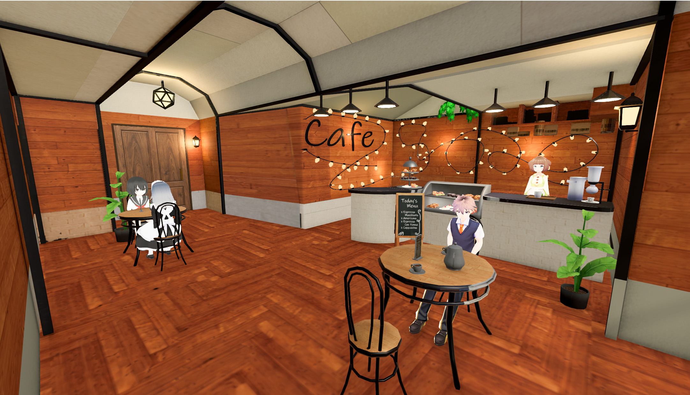
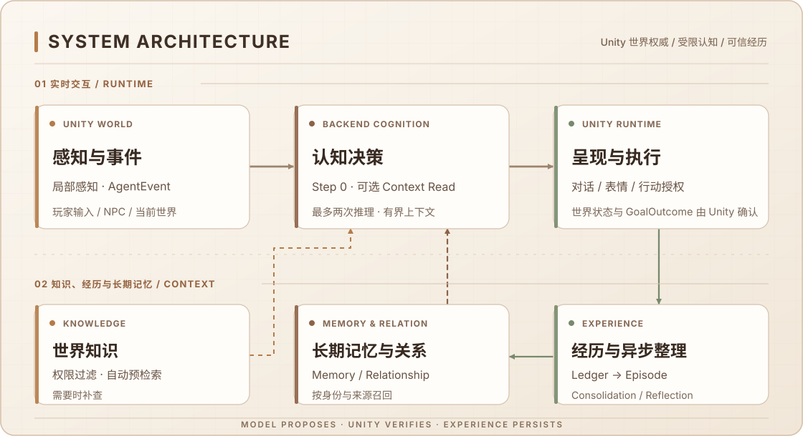

简体中文 | [English](README.en.md)

# ☕ EmbodiedNPC

**让游戏 NPC 的对话连接感知、记忆与实际行动。**

🚧 Early Prototype · 持续开发中

Unity 6 · Python / FastAPI · 长期记忆 · 本地 / 远程 LLM

EmbodiedNPC 是一个面向游戏场景的多 NPC 认知与交互实验项目。当前提供**单机咖啡馆 Demo**：四名拥有独立人设的 NPC 可以与玩家交谈，具备相应能力的角色可以递送物品、制作饮品或清理台面。

项目探索的是一条真实的闭环：**感知 → 认知 → 记忆与行动 → 世界反馈 → 后续交互**。模型结合角色经历和局部环境提出回复或行动，由 Unity 检查并执行，再将实际结果记录为后续可用的经历。当前角色自主性和可执行行动有限，尚不是通用、完整的 Agent 框架。

<p align="center">
  
</p>

## 下载试玩

[下载 Windows x64 试玩 ZIP](https://github.com/LYFshota/EmbodiedNPC/releases/download/v0.1.4-preview/EmbodiedNPC-Windows-x64-v0.1.4-preview.zip) · [Pre-release 说明](https://github.com/LYFshota/EmbodiedNPC/releases/tag/v0.1.4-preview)

1. 完整解压后运行 `Start.cmd`，无需安装 Unity Editor 或单独安装 Python。
2. **自行配置主模型（Main LLM）**，用于对话与决策。试玩包内置 EmbeddingGemma-300M Q4 ONNX，用于记忆向量，无需额外下载或配置 Embedding API；也可选择外部 Embedding 或关闭向量能力。
3. 个人设置与记忆保存在包内 `UserData`。更新前请正常退出并备份。

## 目前实现了什么？

- **多角色对话**：四名 NPC 拥有独立人设、性格和对话风格，支持中文、英文交流，并结合近期对话延续话题。
- **长期记忆与经历整理**：记录实际交流和行动经历，在后台整理为长期记忆，并按需召回；整理与召回仍可能出错。
- **世界知识管理**：内置 156 条咖啡、人物与街区背景知识，可搜索、编辑、新增、导入导出，并设置哪些 NPC 知道、如何使用。
- **局部感知与旁听**：感知附近场景，在范围和遮挡条件允许时记录附近文字发言；旁听不会自动触发插话。
- **场景行动与反馈**：具备相应能力的 NPC 可递送物品、制作十种热饮、清理台面；游戏检查并执行行动，将实际结果反馈给认知与记忆。
- **持久任务与见面约定**：保存有限的未来委托，在下次见面或合适时机考虑执行，支持延期与取消；保存约定不代表已经完成。
- **表情与动作表现**：对话动作、表情和交流节奏可因角色而异，偶尔使用开心、疑惑、惊讶、思考图标辅助表达。
- **独立模型配置**：主模型和向量检索模型分别配置，支持本地或远程服务。
- **体验数据导出**：从设置中导出聊天、记忆、人设、知识、关系和任务等已保留数据，便于保存或反馈问题。导出可能包含个人信息，分享前需自行检查，游戏不会自动上传。

### v0.1.4-preview 更新

- **日常聊天**：四名 NPC 各新增 12 条生活背景，共 156 条默认知识。加强省略式追问的话题承接，减少重复讲述、机械反问和无关点单引导；实际表达仍取决于模型。
- **对话分段**：头顶气泡与聊天记录共用显式分段规则，最多三个气泡；头顶第一段立即显示，后续间隔 2 秒，留存 20 秒；聊天记录一次性显示，一轮仍只保存一条回复。
- **可信行动回顾**：原订单仍在近期对白窗口内时，对应可信终态可随对白进入上下文；历史成功与当前任务状态分别呈现，不扩大通用 900 秒近期结果窗口。
- **有界并发**：云端默认总/前台/后台 **6/6/2**，Ollama 默认 **1/1/1**。设置 → 开发者工具 → **并发调整**，保存并应用后重启生效。独立 NPC 推理及后台 Episode、关系反思、记忆维护可以并行，保留必要的同关系对/范围顺序和安全关闭。

已有玩家的自定义知识目录不会被新版默认内容覆盖。需要体验新增默认背景时，请先导出备份，再在世界知识页显式恢复系统默认；此操作会替换当前目录。

## 系统架构

<p align="center">
  
</p>

[Mermaid 简化结构图](Docs/Images/architecture-overview.mmd)

图中是普通交互的概览；回复、不行动和行动提案是不同结果，只有行动提案进入行动检查与执行流程。后台记忆处理也不要求每轮对话同步等待。

- **Unity 世界权威**：Unity 掌握当前世界状态、局部感知、角色能力和行动结果；模型只能提出建议，不能用一句话改写世界。
- **受限两步认知**：普通对话第一步可直接回复、不行动或提出行动，也可申请一次上下文读取；需要补充信息时，第二步必须给出最终决策，不继续循环调用工具。
- **混合上下文读取**：先自动装入授权背景并检索相关世界知识，再按需批量补读知识、历史记忆或任务；近期对话和关系摘要提供交流背景。读取受身份、访问范围与上下文预算约束，不把整个记忆库塞进提示词。
- **长期记忆与异步反思**：实际经历先留存来源，再由后台整理为事件记忆、语义事实，或跨经历形成暂定洞察；关系反思单独处理社会印象。历史记忆和推断不能替代当前世界事实。
- **行动权限**：Backend 检查提案结构与可用能力，Unity 再独立检查事件来源、执行资格和当前条件。角色人设或知识描述不会授予额外行动权限，通过检查也不等于执行成功。
- **结果反馈**：真正呈现的对话与 Unity 报告的成功、失败、取消等结果进入经历记录，供后续交互使用；口头承诺、计划或未显示的回复不算已完成行动或已发生对话。

实现流程、特殊事件路径与具体边界见 [详细架构](Docs/ARCHITECTURE.md)。

## 技术文档

| 想了解什么 | 从这里开始 |
| --- | --- |
| 系统如何运转，谁负责什么 | [架构与权威边界](Docs/ARCHITECTURE.md) |
| 经历如何变成长期记忆，如何召回 | [记忆系统](Docs/MEMORY.md) |
| 世界知识与持久任务 | [世界知识](AIBackend/WORLD_KNOWLEDGE.md) · [任务系统](Docs/NPC_TASK_SYSTEM.md) |
| 安装、模型配置与运行问题 | [源码运行](Docs/SOURCE_SETUP.md) · [运维说明](Docs/OPERATIONS.md) |
| 扩展与对接 | [Backend](AIBackend/README.md) · [通信协议](Contracts/README.md) · [贡献指南](CONTRIBUTING.md) |
| 版本包含什么，验证到哪一步 | [发布范围与验证边界](Docs/RELEASE_STATUS.md) |

更多条目见 [文档索引](Docs/README.md)。

## 当前限制

- 当前围绕单机、四名 NPC 的固定咖啡馆 Demo 实现，场景依赖较强；自主行为和行动种类有限。多人交流、大规模 NPC 和通用框架仍是探索方向。
- 模型可能理解偏差、重复提问或生成缺乏依据的回复；长期记忆整理、召回和反思也可能出错，不能保证准确记住每次交流。
- 不同 VRM 的表情能力和视觉效果可能不同；文字气泡和程序化动作不代表已实现语音识别、语音合成或通用口型同步。
- 底层架构与交互体验仍在调整。既有验证针对具体版本和场景，不代表所有模型、所有交互或全新机器都已验证，详见 [发布范围](Docs/RELEASE_STATUS.md)。

## 从源码运行

当前主要面向 Windows 本机开发，需要 **Unity 6000.5.10f1**、**Python 3.12 x64**、Git，以及自行准备的可用主模型服务。

> **💡 运行前请注意**
>
> - 项目不包含主模型，需要自行配置可用的本地或远程 LLM 服务。
> - 内置 Embedding 权重不随源码提供，可按文档准备，也可在首次保存配置前选择外部 Embedding 或关闭向量能力。
> - Unity 首次导入会自动检查并修复六项 VRM/GLB 的不完整产物，无需手动 Reimport 或重生成场景；等待模型就绪后运行 TitleScene。验证范围与失败诊断见 [源码运行说明](Docs/SOURCE_SETUP.md)。

1. 从仓库根目录打开 PowerShell，安装依赖并启动 Backend：

   ```powershell
   cd .\AIBackend
   py -3.12 -m venv .venv
   .\.venv\Scripts\python.exe -m pip install -r requirements.txt
   .\.venv\Scripts\python.exe -m uvicorn app.main:app --host 127.0.0.1 --port 8000 --no-proxy-headers
   ```

2. 用 Unity Hub 打开 `UnityClient`，等待包和资源导入完成，运行 `Assets/Scenes/TitleScene.unity`，从标题页进入咖啡馆。
3. 按提示配置主模型和 Embedding，保存后按提示重启 Backend，使配置生效。

完整的环境安装、模型资源准备和首次导入处理见 [源码运行说明](Docs/SOURCE_SETUP.md)。请勿重新生成场景或复制他人的 Library 来处理首次导入。

## 🤖 推荐模型与效果对比

不同大模型在 NPC 对话、记忆运用和行动决策方面的表现有所差异。以下是项目在 100 个固定 NPC 情境中的测试结果，可作为模型选择的参考。

| 模型 | 测试成绩 | 使用建议 |
| --- | ---: | --- |
| GLM-5.3 Flash | **89/100** | ⭐ 云端优先推荐 |
| Gemini 3.8 Flash | **88/100** | ⭐ 云端优先推荐 |
| DeepSeek V4.1 Flash | **87/100** | ⭐ 云端优先推荐 |
| Qwen3.8 Flash | 82/100 | 云端备选 |
| Qwen3.8-27B W8A8 | 78/100 | 高算力本地部署 |
| Nemotron 3.5 BF16 | 66/100 | 部署与模型实验 |
| Qwen3.5-9B | 56/100 | 小模型实验 |
| Qwen3.5-4B | 39/100 | 轻量化研究 |

## 接下来想探索的方向

- **💬 更自然的多角色交流**：探索多个玩家与 NPC 在同一场景中自由交流，让角色能够主动发言、互相回应，并处理多方同时参与的交互。
- **🧠 更持续的角色认知与社会关系**：尝试让 NPC 保留更持续的社会记忆，发展角色之间的关系和长期目标，并结合经历与当下情境选择社交和行为。
- **🌍 更丰富的自主行为与世界互动**：扩展行动、持续任务和角色协作，探索这些行为如何影响游戏世界，以及从互动中逐渐形成的故事。
- **🛠️ 更易扩展的开发框架**：逐步减少对咖啡馆场景的依赖，让开发者更方便地创建角色、配置认知与记忆、扩展行为，并接入自己的 Unity 场景。
- **⚡ 模型与运行效率优化**：研究不同模型的适配、推理开销和多 NPC 并行运行，尝试在有限硬件下保持合理的交互体验。

以上只是目前正在探索的方向，具体实现方式和优先级可能调整，也暂时没有固定的完成时间。如果你对其中某个方向有经验或想法，欢迎通过 Issue 一起讨论。

## 🤝 交流与参与

如果你在体验或部署过程中遇到问题、发现 Bug，或者对项目架构、功能和未来开发方向有建议，欢迎通过 [GitHub Issues](https://github.com/LYFshota/EmbodiedNPC/issues)、Pull Requests 或电子邮件 [952650555@qq.com](mailto:952650555@qq.com) 交流。

不必从大功能开始，修复一个小问题、补充一段说明，同样很有帮助。提交前可以看看 [贡献指南](CONTRIBUTING.md)；反馈问题时附上复现步骤和脱敏日志，请不要上传 API Key、私人对话或存档数据库。

## 📄 开源与许可

原创核心代码、原创文档和配置模板采用 **Apache-2.0**。第三方代码、美术、角色、动画、字体和音频遵循各自许可，完整 Unity 资源不能一概视为可自由商用。

项目方有权授权的原创美术按 [资源级清单](ThirdPartyNotices/Project_Art.md) 采用 CC0 1.0；不覆盖第三方派生资源。星芒按[独立项目内非商业许可](UnityClient/Assets/VRMCompatibilityTest/Xingmang.LICENSE.md)授权，允许在 EmbodiedNPC 及其 Fork 内非商业使用、修改、改作，并随源码或游戏构建分发原始模型或修改版；未经单独授权不得商用，也不得单独销售或作为独立素材包分发。该素材许可不限制原创 Apache-2.0 代码商用，辉歪歪署名和现有用途限制保留，具体资产与元数据见[资产清单](ThirdPartyNotices/Xingmang_Assets.md)。

详细信息请参阅 [LICENSE](LICENSE)、[NOTICE](NOTICE) 和 [THIRD_PARTY_NOTICES](THIRD_PARTY_NOTICES.md)。
