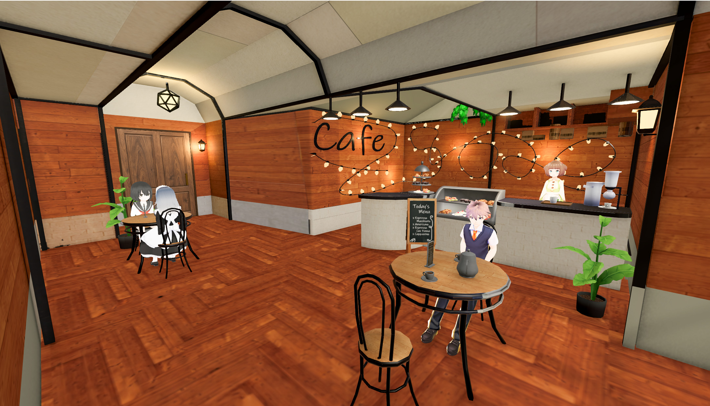
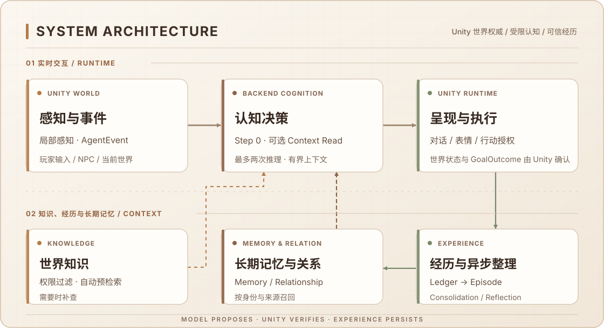

简体中文 | [English](README.en.md)

# ☕ EmbodiedNPC

**让游戏 NPC 不只是回答问题，还能记住玩家、理解场景并付诸行动。**

Unity 6 · Python / FastAPI · AI Agent · 长期记忆 · 本地 / 云端 LLM

EmbodiedNPC 是一个探索**游戏 NPC 长期交互与自主行为**的开源项目。目前以单机咖啡馆为演示场景，包含林薇薇、沈知意、温予安和江亦舟四名 NPC。你可以和他们聊天，聊起之前的经历，也能请店员制作饮品、拿取点心，观察角色在咖啡馆里的日常活动。

项目的核心是一条可运行的闭环：**感知 → 认知 → 记忆 / 行动 → 世界反馈 → 下一次交互**。

<p align="center">
  
</p>

## ✨ 核心能力

- **有个性的多 NPC 对话**：四名角色拥有不同的背景、性格和交流习惯，支持中英文交谈，能够结合近期对话承接话题。
- **长期记忆与关系认知**：记录真实对话与行动经历，在后台整理 Episode、长期记忆与角色关系，让后续交流能够参考共同经历。
- **可查询的世界知识**：内置 161 条咖啡馆、角色和街区知识，支持按角色配置知识范围，以及搜索、编辑、导入和导出。
- **感知与真实行动**：NPC 根据局部环境、角色能力与玩家需求提出行动；Unity 验证并执行制作饮品、清洁柜台、递物、点心服务等操作，再反馈实际结果。
- **持续任务**：能够记录部分未来委托与见面约定，支持后续执行、延期和取消。
- **更自然的场景表现**：薇薇会在柜台内走动、停留和擦拭；温予安与江亦舟会偶尔拿杯饮用；玩家拥有待机微笑和动作表情联动。
- **多 NPC 并发与可配置模型**：前台对话和后台记忆任务支持有界并发；主模型、Embedding 与相关运行参数可分别配置。

### 最新试玩版：v0.1.6-preview

这次主要优化了**首次配置、模型连接和游戏交互体验**。

- **启动更方便**：双击「启动游戏.cmd」即可启动，自动处理端口占用。
- **模型配置更简单**：优化 AI 配置页面、API 兼容性和错误提示，方便使用不同的模型服务。
- **交谈更自然**：玩家会平滑转向正在交谈的 NPC，对话结束后恢复原本方向。

## 🎮 下载试玩

**[下载 Windows x64 试玩版](https://github.com/LYFshota/EmbodiedNPC/releases/download/v0.1.6-preview/EmbodiedNPC-v0.1.6-preview-Windows-x64.zip)** · [查看已发布的 v0.1.6-preview 说明](https://github.com/LYFshota/EmbodiedNPC/releases/tag/v0.1.6-preview)

1. 完整解压后双击「启动游戏.cmd」（`Start.cmd` 仍可使用），无需单独安装 Unity 或 Python。
2. 打开「设置 → AI 配置」，填写自己的主模型、API Key 和接口地址；保存后按提示重启。包内「使用说明.html」提供配图教程。
3. 进入咖啡馆，和 NPC 交谈、提出委托，或观察他们的日常生活。

试玩包已包含本地记忆向量模型 **EmbeddingGemma-300M Q4 ONNX**；主聊天模型和 API Key 需要自行准备。

## 🧩 系统架构

<p align="center">
  
</p>

**Unity 负责世界，Python Backend 负责认知，记忆与行动结果连接多次交互。**

- **感知与事件**：Unity 从场景、交互和附近角色生成 NPC 可以观察到的事件。
- **认知与上下文**：Backend 结合人设、近期对话、世界知识、记忆及关系信息，生成回复或行动提案；按需补充上下文。
- **行动与反馈**：正式行动通过能力及状态检查后由 Unity 执行，结果返回认知与经历记录。日常动画则由 Unity 本地行为层驱动。
- **长期记忆**：经历以 Episode 为单位进行异步整理与检索，关系反思独立维护，支持跨会话持续交流。
- **并发调度**：不同 NPC 的模型调用和后台工作可并行执行，并保留必要的单角色与数据范围约束。

想深入了解实现，可以阅读 [系统架构](Docs/ARCHITECTURE.md)、[记忆系统](Docs/MEMORY.md) 和 [通信协议](Contracts/README.md)。

## 🛠️ 从源码运行

开发环境：**Unity 6000.5.10f1、Python 3.12 x64、Git、Windows**。

1. 克隆仓库，并在 `AIBackend` 目录创建 Python 环境、安装依赖、启动服务：

   ```powershell
   cd AIBackend
   py -3.12 -m venv .venv
   .\.venv\Scripts\python.exe -m pip install -r requirements.txt
   .\.venv\Scripts\python.exe -m uvicorn app.main:app --host 127.0.0.1 --port 8000 --no-proxy-headers
   ```

2. 使用 Unity Hub 打开 `UnityClient`，等待资源导入后运行 `Assets/Scenes/TitleScene.unity`。
3. 在游戏内配置主模型及 Embedding，按提示保存并重启 Backend。

**注意：** 源码仓库不包含 Embedding 权重；请按 [源码运行指南](Docs/SOURCE_SETUP.md) 准备，或选择外部 Embedding / 关闭向量检索。Windows 试玩包已预置该资源。

## 📊 模型测试

项目使用 **100 个固定 NPC 情境**对模型的对话、记忆与行动决策进行评估，以下是对应实验成绩（非通用模型榜单）：

| 模型 | 得分 |
| --- | ---: |
| GLM-5.3 Flash | **89 / 100** |
| Gemini 3.8 Flash | **88 / 100** |
| DeepSeek V4.1 Flash | **87 / 100** |
| Qwen3.8 Flash | 82 / 100 |
| Qwen3.8-27B W8A8 | 78 / 100 |
| Nemotron 3.5 BF16 | 66 / 100 |
| Qwen3.5-9B | 56 / 100 |
| Qwen3.5-4B | 39 / 100 |

## 📚 文档

| 主题 | 文档 |
| --- | --- |
| 架构与数据流 | [ARCHITECTURE](Docs/ARCHITECTURE.md) |
| 长期记忆 | [MEMORY](Docs/MEMORY.md) |
| 世界知识、未来任务 | [WORLD_KNOWLEDGE](AIBackend/WORLD_KNOWLEDGE.md) · [NPC_TASK_SYSTEM](Docs/NPC_TASK_SYSTEM.md) |
| 源码部署与运行 | [SOURCE_SETUP](Docs/SOURCE_SETUP.md) · [OPERATIONS](Docs/OPERATIONS.md) |
| Backend 与 Unity 协议 | [Backend](AIBackend/README.md) · [Contracts](Contracts/README.md) |
| 参与开发 | [CONTRIBUTING](CONTRIBUTING.md) |

更多内容见 [文档索引](Docs/README.md)。

## 🌱 接下来

持续改进 **NPC 自然对话、长期关系演化、非语言表现和场景自主行为**，并逐步让角色与场景配置更加可复用。

欢迎通过 [Issues](https://github.com/LYFshota/EmbodiedNPC/issues) 反馈体验、提出想法，或提交 Pull Request。也可以邮件联系：[952650555@qq.com](mailto:952650555@qq.com)。

## 📄 许可

项目原创代码与文档采用 **Apache-2.0**；第三方模型、美术、动画、字体等资源保留各自许可。其中玩家角色**星芒**使用单独的项目内非商业授权。

详见 [LICENSE](LICENSE)、[THIRD_PARTY_NOTICES](THIRD_PARTY_NOTICES.md) 和 [星芒资源许可](UnityClient/Assets/VRMCompatibilityTest/Xingmang.LICENSE.md)。
